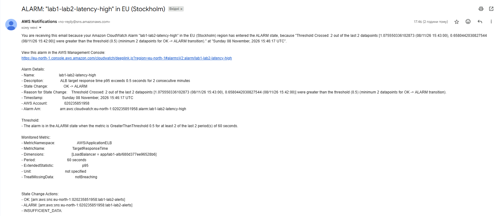
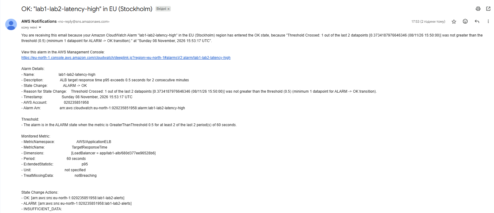
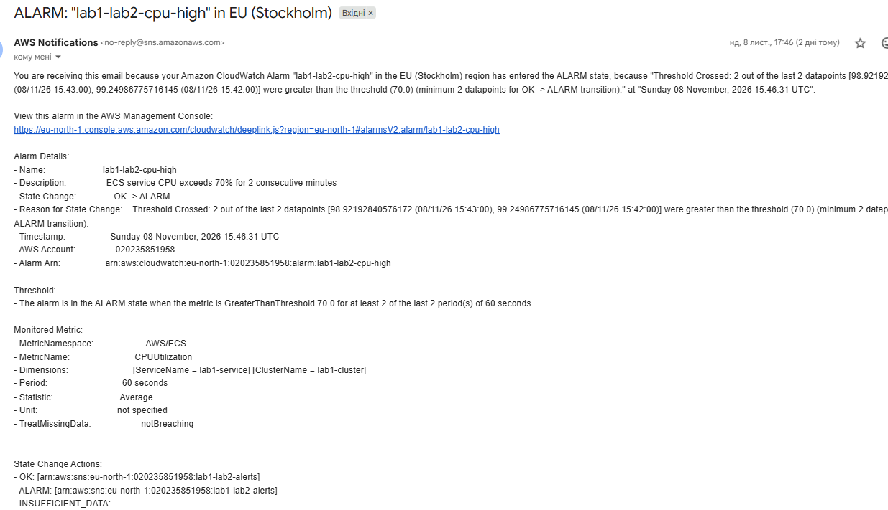
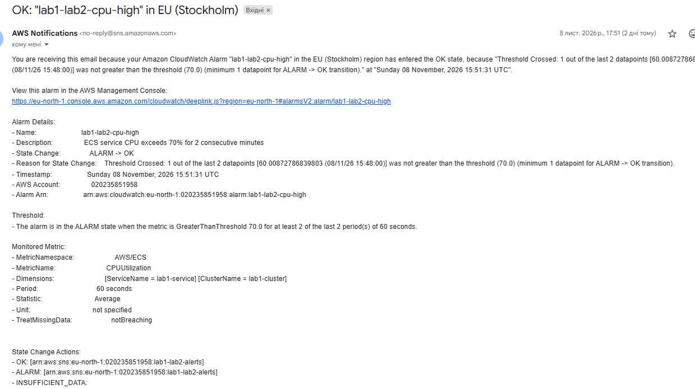

# Сповіщення CloudWatch

## Налаштування сповіщень

Для контролю навантаження налаштовано два CloudWatch Alarms:

| Сповіщення | Умова |
|---|---|
| CPU High | CPU понад 70% протягом 2 хв |
| Latency High | p95 понад 500 мс протягом 2 хв |

Поріг CPU 70% вибрано для виявлення високого навантаження на процесор, а p95 500 мс — для контролю часу відповіді. Умова протягом 2 хвилин дозволяє уникнути сповіщень через короткочасні стрибки.

Для надсилання листів використано Amazon SNS. Налаштування виконано через Terraform у файлі `deploy/aws/terraform/alerts.tf`.

## Результати перевірки

Під час тесту на 100 VU обидва Alarms спрацювали та надіслали листи. Після зниження навантаження надійшли повідомлення про повернення до нормального стану.

Стала фаза навантаження почалася о 17:43:28. Перші сповіщення надійшли приблизно через 3 хвилини.

| Сповіщення | ALARM | OK |
|---|---|---|
| CPU High | 17:46:31 | 17:51:31 |
| Latency High | 17:46:17 | 17:53:17 |

### Отримані листи

