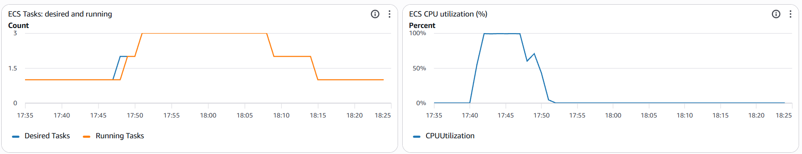
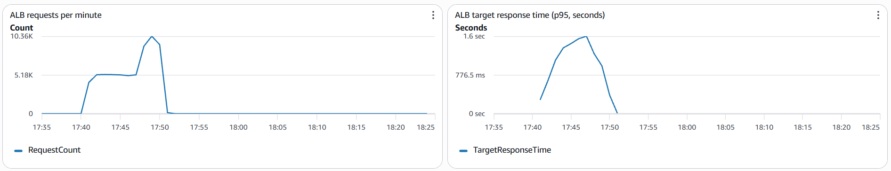
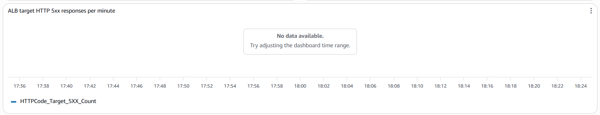

# Автоматичне масштабування

## Опис

У лабораторній роботі №1 було розгорнуто REST-сервіс в AWS ECS Fargate. У цій роботі налаштовано автоматичне масштабування, щоб AWS додавав контейнери при збільшенні навантаження та прибирав зайві після його зниження.

Налаштування виконано через Terraform у файлі `deploy/aws/terraform/autoscaling.tf`.

## Параметри масштабування

Для масштабування використано політику `TargetTrackingScaling` з такими параметрами:

| Параметр | Значення |
|---|---|
| Мінімальна кількість Tasks | 1 |
| Максимальна кількість Tasks | 3 |
| Метрика | `ECSServiceAverageCPUUtilization` |
| Цільове завантаження CPU | 60% |
| Scale-out cooldown | 60 с |
| Scale-in cooldown | 300 с |

Цільове значення CPU 60% вибрано, щоб залишити запас продуктивності для обробки додаткових запитів. Максимальну кількість обмежено трьома Tasks, щоб не використовувати зайві ресурси.

## Період стабілізації (cooldown)

Cooldown — це період стабілізації після масштабування, який допомагає уникнути занадто частих змін кількості контейнерів.

Для scale-out встановлено 60 секунд, щоб AWS міг швидше реагувати на зростання навантаження. Для scale-in — 300 секунд, щоб не прибирати контейнери при короткочасному спаді.

Якщо встановити cooldown = 0, система може занадто часто додавати та прибирати контейнери при коливаннях навантаження. Це призводить до зайвих запусків і витрат.

## Моніторинг у CloudWatch

Через Terraform у файлі `deploy/aws/terraform/dashboard.tf` створено Dashboard `lab1-lab2-dashboard`. Для отримання даних про кількість Tasks увімкнено Container Insights.

На панелі налаштовано п'ять графіків: Desired і Running Tasks, CPU Utilization, кількість запитів за хвилину, латентність p95 та HTTP 5xx.

## Результати тестування

8 листопада 2026 року проведено 10-хвилинний тест із максимальним навантаженням 100 віртуальних користувачів (VU). Стала фаза тривала з 17:43:28 до 17:48:28.

Під час тесту CPU досягав майже 100%. AWS збільшив бажану кількість Tasks до 2 ще під час сталої фази, а згодом — до 3. Після завершення навантаження кількість контейнерів автоматично повернулася до 1.

### Графіки CloudWatch

На першому графіку видно збільшення та подальше зменшення кількості Tasks. Основні моменти тесту:

| Час | Подія |
|---|---|
| 17:40:28 | Початок навантаження |
| ≈17:41–17:42 | CPU перевищив цільові 60% |
| 17:47:34 | AWS збільшив Desired Tasks до 2 |
| ≈17:49 | Друга Task почала працювати |
| 17:50:34 | AWS збільшив Desired Tasks до 3 |
| 18:08:16 | Зменшення Desired Tasks до 2 |
| 18:14:16 | Повернення Desired Tasks до 1 |

Масштабування до 2 Tasks почалося під час сталої фази, проте фактичний запуск другого контейнера відбувся пізніше.

Під час навантаження кількість запитів зросла приблизно до 10 тис. за хвилину, а p95 — до 1,6 с за графіком CloudWatch. Після завершення тесту обидва показники знизилися.

Графік HTTP 5xx показував `No data available`. При цьому k6 зафіксував 0% невдалих HTTP-запитів.

## Пояснення результатів

Між перевищенням CPU 60% і запуском нової Task минув час, оскільки AWS спочатку аналізує метрики, приймає рішення про масштабування, а потім ECS запускає контейнер і перевіряє його готовність.

Зменшення кількості Tasks відбулося значно пізніше за спад навантаження. Це пов'язано з cooldown 300 секунд та обережнішим масштабуванням вниз, щоб не прибирати контейнери завчасно.