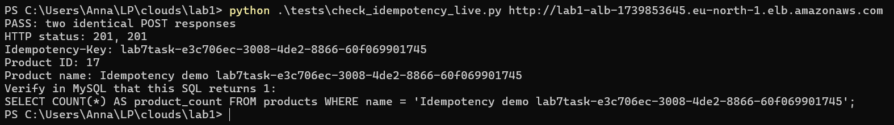

# Ідемпотентність операцій запису

Ідемпотентність реалізовано для `POST /api/products` через заголовок `Idempotency-Key`. Вона запобігає повторному створенню товару при повторному надсиланні того самого запиту.

Перший POST створює товар у MySQL, а результат зберігається в Redis на 24 години (86400 с). Повторний запит із тим самим ключем і даними повертає збережену відповідь без нового запису в базу. Для захисту від одночасних запитів використано `SET NX`. Повтор під час обробки або використання ключа з іншими даними повертає `409 Conflict`.

## Перевірка

Скриптом `tests/check_idempotency_live.py` надіслано два однакові POST-запити до AWS ECS.

Обидва запити повернули HTTP `201`, однакові відповіді та ID товару `17`.

Додатково виконано SQL-запит `SELECT COUNT(*)` за унікальною назвою товару. Результат — **1 запис у MySQL**.

## Поєднання із завданням №6

При асинхронній обробці через чергу ідемпотентність запобігала б повторному додаванню того самого завдання.

## Висновок

Ідемпотентність працює: два однакові POST-запити повернули однаковий результат, а в MySQL створено лише один товар.