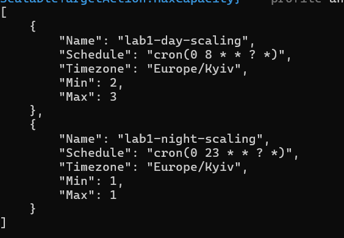

# Масштабування за розкладом

У Terraform налаштовано автоматичне масштабування ECS за київським часом (`Europe/Kyiv`):

- **08:00–23:00** — мінімум 2, максимум 3 Tasks.
- **23:00–08:00** — 1 Task.

Розклад реалізовано у файлі `deploy/aws/terraform/schedule.tf`.

### Перевірка

Через AWS CLI перевірено, що обидва розклади створені з правильними параметрами.

### Розрахунок місячної економії

Орієнтовна вартість однієї Fargate Task (0.25 vCPU, 0.5 GB RAM) — **$0.013575/год**.

За 30 днів:

- Постійно 2 Tasks: `2 × 24 × 30 × 0.013575 = $19.55`.
- За розкладом: `(2 × 15 + 1 × 9) × 30 × 0.013575 = $15.88`.

**Економія: $3.67/місяць (18.75%).**

Розрахунок враховує лише Fargate, без додаткового масштабування до 3 Tasks та вартості інших AWS-сервісів.